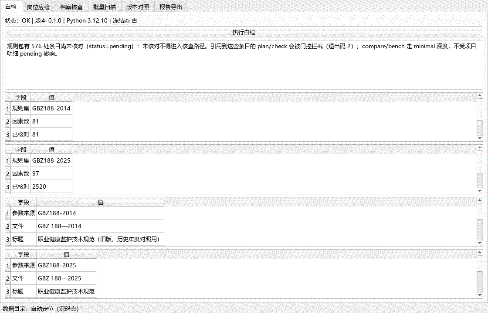

# occupational-health-surveillance-checker

职业健康监护合规核查工作台 —— 以强制性国家职业卫生标准 **GBZ 188—2025《职业健康监护技术规范》**（国卫通〔2025〕10 号，**2026-08-01 施行**）为规则源，把**危害因素 × 检查项目 × 检查周期监护矩阵 + 监护档案覆盖度核查 + 双版本对照（2025 版 vs 2014 版）+ 批量档案对账 + 报告导出**做成**逐项挂条款依据、可复现、留指纹**的本地工具（桌面 exe + CLI 双形态）。

> 本地目录 `10-14-occupational-health-surveillance-checker`（`10-14` = 2026-10-14 日期标签）。GitHub 仓库名发布时用纯净名 `occupational-health-surveillance-checker`，见 [plan/00-README总览.md](plan/00-README总览.md)。

**全本地处理、零上传**：监护档案含劳动者个人健康信息（敏感个人信息），工具默认不联网、不做任何数据外发。

> 状态：🚧 **M5 完成（2026-10-14）**——M0 骨架 → M1 数据先行（GBZ 188—2025 第 5–7 章 82 因素逐条挂原文核对 + 双版本规则包 + 72 件合成真值库）→ M2 监护矩阵引擎与覆盖度判定 → M3 批量/对账/报告与证据链 → M4 内置基准（可证伪探活）→ **M5 桌面交付与打包（GUI 六页签 + onedir 双 exe + 冻结态自检与中立目录验收 + 演示素材 + 技术报告）**。
> **当前规则包**：`data/rules/` 第 5–7 章（82 因素 / 2520 条项目明细）已逐条挂官方原文核对（`verified`），第 8–9 章 15 因素仅因素身份核对、明细 `pending`（核查时被门控拦截并提示）。基准与演示由**合成规则集**（`data/benchmark/`）驱动，与生产规则包刻意分离。
> 下一步：M6 脱敏发布与收尾，见 [plan/HANDOFF-M6.md](plan/HANDOFF-M6.md)。
> **诚实性说明**：本机**未接远端**，CI workflow 已就位但**一次都没跑过**（"未推送 = 未跑 CI"），首推验证安排在 M6。

---

## 它解决什么问题

| 痛点 | 本工具的能力 |
|---|---|
| 这个岗位接触某危害因素，该做哪些检查项？ | 危害因素 → 应检项目清单确定性推导（上岗前/在岗期间/离岗时/应急四类） |
| 多久查一次？ | 规则包承载各危害因素检查周期，逐人判定是否超期 |
| 这次体检做全了没有？ | 应检 vs 实检逐项比对，输出缺项清单挂条款依据 |
| 2026-08-01 换新标准了，旧档案还能用老口径吗？ | 双版本规则集 + 按体检年度锚定版本 + 差异对照 |
| 档案以千份计，逐份点开不现实 | 批量扫描 + 失败件隔离 |
| 整改是循环的，"这轮比上轮好了没" | 跨轮对账：新增缺项 / 已补齐 / 持续缺失 |
| 结论要能交给检查/存档 | 报告导出（Markdown + XLSX）+ 档案 sha256 指纹 |

## 规则库版本化与 status 门控（本项目的核心纪律）

规则库按 **`依据文件 × 版本`** 组织（`data/rules/`），监护规则编码为可执行规则（JSON）。每条挂标准号/节号与 `status`：

- `verified` —— 已逐条挂原文核对，**可进入核查路径**；
- `pending` —— 待核对，**绝不参与任何核查或判定**。

**未挂原文核对的条目不得落库生效**。体检年度锚定规则版本：`GBZ 188—2014` 与 `GBZ 188—2025` 是两套独立规则集，切换即切口径。

## 依据锚点（基准日 2026-10-14 核验）

| 依据 | 编号 | 状态 |
|---|---|---|
| 职业健康监护技术规范 | **GBZ 188—2025** | ✅ 国卫通〔2025〕10 号发布（2025-08-20）、**自 2026-08-01 施行**、**代替 GBZ 188—2014**（通告原文核对；官方全文 PDF 已解析） |
| 同上（旧版，历史年度对照） | **GBZ 188—2014** | ✅ 因 2025 版施行**同时废止**（含施行日在 2026 年内）；⬜ 原发布文号入库时核对 |
| 职业病危害因素分类目录 | **国卫疾控发〔2015〕92 号** | ✅ 文号存在；⬜ 原文入库时核对 |

> **基准日核验**：**2026 年内即发生替代/作废**——GBZ 188—2025 于 2026-08-01 施行、GBZ 188—2014 同时废止（该替换为 2025 年发布、2026 年生效的跨年施行）。

## 快速开始（M0 已可用；真实核查待 M1 数据入库）

要求 Python 3.8+（核心功能**零第三方依赖**）。

```bash
python -m venv .venv
# Windows(Git Bash): source .venv/Scripts/activate    Linux/macOS: source .venv/bin/activate
python -m pip install -U pip
python -m pip install -e ".[dev]"
```

```bash
ohscheck selfcheck             # 数据目录定位 + 规则库加载 + status 门控计数
ohscheck plan <岗位画像.json>   # 应检项目与周期推导（人类可读 / --json）
ohscheck check <档案.json>      # 监护档案覆盖度核查
ohscheck scan <档案目录> --out <报告目录>   # 批量扫描 + 报告导出
ohscheck scan <档案目录> --baseline <上一轮目录> --out <报告目录>   # 批量 + 跨轮对账
ohscheck compare               # 双版本差异对照
ohscheck report <输出目录> --position <岗位.json> --directory <档案目录> \
         --generated-at 2026-10-14T00:00:00    # Markdown + XLSX + 证据链
ohscheck bench                 # 内置评测基准（四套件，门槛随 manifest 下发）
ohscheck version
```

**退出码**：`0` 无不符合 / 基准达标 · `1` 检出不符合 / 基准未达标 · `2` 用法·输入·门控拦截·待输入·年度歧义·门槛缺失 · `3` 缺可选依赖（GUI）。

### 桌面界面（M5）

```bash
python -m pip install -e ".[gui]"
python -m ohscheck gui          # 六页签：自检 / 岗位应检 / 档案核查 / 批量扫描 / 版本对照 / 报告导出
```

GUI 与 CLI **同一编排层**（`engine/pipeline.py`）取数，行为等价有测试背书（CLI stdout == pipeline 直调 == GUI 服务层 == 报告章节，`tests/test_m5.py`）；界面只渲染结果、零判定逻辑，且有 AST 三条守门锁死（不 import 规则层 + 无算术 + 无政策数值字面量）。



**打包（免安装双 exe）**：

```bash
python -m pip install -e ".[build]"      # PyInstaller >= 6（打 GUI 硬下限）
python tools/gen_spec.py --check         # spec 由 datas 白名单单一事实源生成（禁手改）
python -m PyInstaller tools/packaging.spec
# → dist/ohscheck/ohscheck-gui.exe + ohscheck-cli.exe（onedir）
ohscheck-cli.exe selftest <out.json>     # 冻结态自检：数据目录落 dist 内 + 规则数 > 0 + 全链路 + 基准
```

**冻结产物再生成**（产物禁手改，改体例走生成器整目录重生成）：

```bash
python tools/gen_rulesets.py --check   # 规则包再生成逐字节一致
python tools/gen_cases.py --check      # 合成夹具再生成逐字节一致
python tools/check_literals.py --selftest   # 零字面量门禁阳性对照（必先跑）
python tools/check_literals.py
```

### M4 期基准指标实测（`ohscheck bench`，Python 3.8.8 / Windows 10.0.26200，2026-10-14）

以下为**实测值**（门槛随 `data/benchmark/manifest.json` 的 `benchmark_thresholds` 下发，运行时长门槛 5.0 秒）：

| 套件 | 用例数 | 指标 | 实测值 | 门槛 | 结论 |
|---|---|---|---|---|---|
| matrix（监护矩阵，样本驱动 + 规则驱动两层） | 5 + 规则驱动 7 | 正确率 | **1.0000** | ≥ 1.0 | 达标 |
| coverage（覆盖度四态判定） | 13 | 正确率 | **1.0000** | ≥ 1.0 | 达标 |
| compare（双版本对照） | 3 | 一致率 | **1.0000** | ≥ 1.0 | 达标 |
| false_positive（误报对照） | 7 | 误报数 | **0** | = 0 | 达标 |
| 运行时长（四套件合计） | — | 墙钟时间 | **0.005 秒** | ≤ 5.0 秒 | 达标 |

**可证伪探活（基准会绿也会红）**：每套件都有注入缺陷的探活测试（篡改期望应检清单 / 打桩周期判定 / 破坏对照差异 / 弄脏"应零命中"档案 / 时长上限压到 0 秒），断言基准**必须**报未达标（exit 1）——只会绿的基准是假基准（`tests/test_m4.py` 15 项）。某类用例未生成时基准输出如实声明"该类用例未生成"并**不假装通过**（`not_enabled` → exit 1）。

> 正确率 1.0000 是合成夹具上的机制正确率（验引擎机制，不验国标内容——合成规则集与生产规则包刻意分离）；误报对照 7 件为真值库声明的"应零命中"档案，**只读声明、不自选考卷**。

## 已知限制（**请先读这一节**）

- **规则库核对进度**：GBZ 188—2025 第 5–7 章（化学 65 / 粉尘 9 / 物理 8，共 82 因素）明细已逐条挂原文核对；第 8–9 章（生物 5 / 特殊作业 10）仅因素身份核对、明细 `pending` → 引用这些因素的核查会被**门控拦截**（退出码 2）并提示。这是**有意的**：未挂官方原文核对的条目绝不参与判定。
- **工具不做"补充检查合规"判定**：应检项集**只取必检项**；标准表述含"必要时"的补充项目与选检项目**不进判定**（缺失不报）。理由是补充项目的条件属临床判断，纳入会制造假阳性——这是**有意划定的边界**，不是遗漏。
- **不做医学判读**：结论代码只做"项目是否齐备"的结构核对，不做医学诊断、职业病诊断与鉴定。
- **周期判定不使用"今天"**：判据是"本次体检日期 vs 上次检查日期 + 规则周期"，保证结果可复现；无基线（首次检查）不报超期。
- **2014 版是差异导向的骨架**：旧版全文官方预览已下架 → 以 GBZ 188—2025 前言"主要技术变化"逐条引述为对照依据，**不作完整重述**；前言未引述的条目保持 `pending`。
- **首期范围**：GBZ 188—2025 第 5–7 章（化学 + 粉尘 + 物理，共 82 因素）；第 8–9 章因素身份已入库、明细待核对。
- **覆盖核查不做模糊匹配**：项目名称归一必须走**显式别名表**（M1 建）；归一不成立的实检项降级为 warning，**不硬判缺失**。
- 本工具输出为**基于标准的监护合规检查发现**，不构成医学意见、职业病诊断或行政认定；正式结论以职业健康检查机构与卫生健康行政部门口径为准。
- 规则条目核对状态以规则库 `status` 为准；**`pending` 条目不参与核查**。
- 演示与基准一律使用**合成监护档案**与**合成规则集**，不含任何真实劳动者信息；合成规则集的出处一律带 `SYNTHETIC-` 前缀，**不得冒充真实标准**。

## 目录结构

```
src/ohscheck/       核心层（零第三方依赖）：规则加载/门控/版本锚定、矩阵与覆盖度判定、批量扫描、对账、报告、基准
  engine/pipeline.py  ★唯一编排事实源（CLI 与 GUI 共用，表现层只准经它取数）
data/rules/         规则包（生成器冻结产物；第 5–7 章已核对，第 8–9 章明细 pending）
data/benchmark/     合成规则集 + 植入真值用例（基准专用，与生产包分离）
data/truth/         合成监护档案真值库（72 档案 + truth.json + manifest.json）
tools/              生成器与门禁（gen_rulesets / gen_cases / gen_synthetic / gen_spec / gen_demo_assets / check_literals）
docs/               技术报告 + 演示素材（assets/，sha256 可复现）
tests/              227 项测试（规则门控 / 引擎 / CLI 退出码 / 报告 / 基准探活 / GUI 守门与三方对账 / 真值对账 / 骨架守门）
plan/               计划文档 00–06 + HANDOFF-M1…M6.md
```

## 里程碑

| 里程碑 | 内容 | 状态 |
|---|---|---|
| M0 | 计划 00–06 定稿 + 可运行骨架（规则加载/门控/矩阵骨架/CLI/测试/CI） | ✅ 完成 2026-10-14（DoD 15/15；CI 待首推验证） |
| M1 | 数据先行：监护规则逐条挂原文核对 + 双版本规则包 + 合成监护档案真值库 | ✅ 完成 2026-10-14（[HANDOFF-M1](plan/HANDOFF-M1.md)） |
| M2 | 监护矩阵引擎：应检项目与周期推导 + 覆盖度判定，算例回归 | ✅ 完成 2026-10-14（[HANDOFF-M2](plan/HANDOFF-M2.md)） |
| M3 | 批量与对账：批量档案扫描 + 跨轮对账 + 群体统计 + 报告/证据链 | ✅ 完成 2026-10-14（[HANDOFF-M3](plan/HANDOFF-M3.md)） |
| M4 | 基准：四套件 + 可证伪探活 + 门槛随 manifest + 指标实测值进 README | ✅ 完成 2026-10-14（[HANDOFF-M4](plan/HANDOFF-M4.md)，指标见上方"M4 期基准指标实测"） |
| M5 | 桌面交付：PySide6 界面 + PyInstaller 打包 + 报告导出 + 技术报告 | ✅ 完成 2026-10-14（[HANDOFF-M5](plan/HANDOFF-M5.md)，GUI 演示见上方） |
| M6 | 脱敏发布 GitHub + Release（exe）+ 收尾固化 | ⬜ 下一步（[HANDOFF-M6](plan/HANDOFF-M6.md)） |

## 开发与测试

```bash
python -m pytest -q          # 227 项（3.8 与 3.12 双通道均绿）
```

CI（`.github/workflows/ci.yml`）按 4 矩阵运行：`{ubuntu, windows} × {3.8, 3.12}`，每步都先跑冻结产物守门与零字面量门禁。

## 许可

MIT，见 [LICENSE](LICENSE)。
